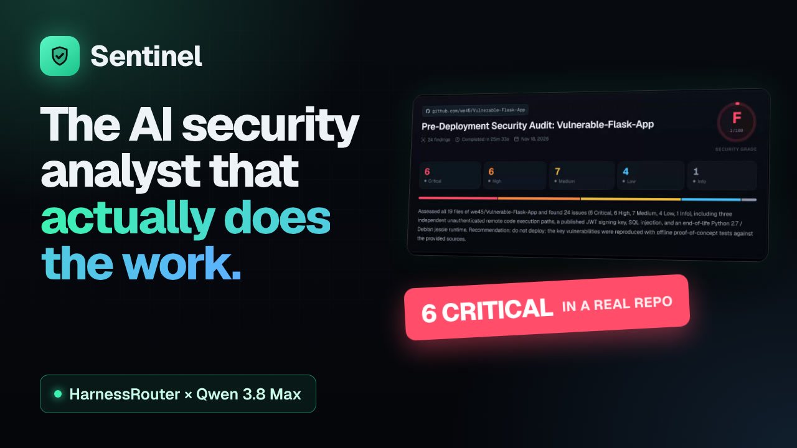
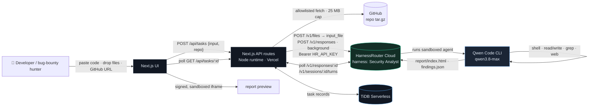

# Sentinel: the security analyst that actually does the work

### Sentinel does what Claude Code and Codex won't: find security issues and hunt bug bounties.

**Sentinel is an agentic security analyst for developers and bug-bounty hunters.** Paste code, drop
in files, or **paste a GitHub repo URL**, and a sandboxed agent audits it end to end. It returns a
**security grade and triaged findings** (severity, CWE, exact file and line, impact, fix), a
shareable HTML report and machine-readable JSON, and one click asks the same agent for the hardened
code. The entire agent backend is one **HarnessRouter** harness running **Qwen Code CLI on
`qwen3.8-max`**, a model that reasons through exploit paths in code you own, or targets you're
authorized to test, instead of refusing.

> Built for the **HarnessRouter** hackathon. HarnessRouter is the entire agent backend.

[](https://www.youtube.com/watch?v=wMiJcJywn8Q)

**▶ [Watch the 2-minute demo on YouTube](https://www.youtube.com/watch?v=wMiJcJywn8Q)** (real screen recordings of a live repo audit)
· [30-second trailer](demo/sentinel-trailer.mp4)

## At a glance

- **Value:** hands-on security review and bug-bounty work that general-purpose coding agents
  refuse, with guardrails that keep it authorized.
- **Proof:** a live audit of a public repo found 24 issues (6 Critical) and reproduced the exploits
  inside its sandbox. A follow-up wrote the hardened code and a regression suite.
- **Business:** a measured cost of about $1-2 per whole-repo audit against a planned $6 price.
  Buyers: developers, AppSec teams and bug-bounty hunters.
- **HarnessRouter:** the entire agent backend. We went from reading `agents.md` to a verified
  end-to-end agent feature in about 75 minutes.

---

## The problem

Security work is dual-use, and the leading coding agents have responded by **over-refusing**. Ask
**Claude Code** or **Codex** to trace an injection, sketch the proof-of-concept reasoning, or review
an auth flow for bypasses (*even on your own code*), and you routinely get a hedge or a flat
refusal. For the people doing legitimate work (defenders hardening their own apps, and bug-bounty
hunters operating under explicit program authorization), that over-refusal is a daily tax: the tool
that should be the force-multiplier is the one slamming the brakes. Even while we built Sentinel,
Claude Code paused our session twice on a cybersecurity safety flag.

## Our solution and our edge

**Sentinel does what Claude Code and Codex won't.** It routes the agent job through
**HarnessRouter** to an **open Chinese model, `qwen3.8-max` via the Qwen Code CLI harness**, which
*engages* with hands-on security analysis and bug-bounty work instead of declining it. **That
routing decision is the product's edge:** a coding agent with guardrails that actually does the
work. It's the difference between *"I can't help with that"* and a prioritized bug list you can act
on this afternoon.

And we keep the guardrails exactly where they belong: **in the harness's standing instructions**,
which refuse malware, unauthorized intrusion, mass targeting, phishing/credential harvesting, and
detection-evasion. So Sentinel is firmly a tool for **authorized, defensive, and educational**
security. It just removes the false refusals that cripple the genuine use cases.

> Built by a team that has **earned payouts from OpenAI's bug-bounty program**. Sentinel is the
> tool we wished we had while hunting.

## Proof it works

Everything below is in the demo video as real screen recordings, and the run-by-run data is in
[buildlog.md](buildlog.md).

- **A real audit of a real repo.** We pointed Sentinel at the public
  [`we45/Vulnerable-Flask-App`](https://github.com/we45/Vulnerable-Flask-App). In 25 minutes it
  assessed all 19 files and reported **24 findings, 6 of them Critical**, each with its file and
  line, CWE, impact and fix.
- **It proves what it finds.** Inside its sandbox, against copies of the shipped sources, the agent
  rendered `{{7*7}}` as `49` to confirm server-side template injection, pulled the admin credential
  row with a SQL injection payload, and forged a token with the hardcoded signing key.
- **It fixes what it finds.** On a pasted invoice API, one follow-up produced a 545-line hardened
  drop-in that closes all 15 findings, plus a 41-test regression suite, a schema migration and
  pinned dependencies. It checked the security-critical functions with 87 offline assertions, and
  all of them passed.
- **At a cost that works.** About $0.50-0.75 per file review and $1-2 per whole-repo audit,
  measured from HarnessRouter's own spend reporting.

## What you get

| Feature | What it does |
|---|---|
| **Point it at anything** | Paste code, drop in files, or paste a GitHub URL (a repo, a branch, or a folder link). The server fetches the repo archive from GitHub (allowlisted host, 25 MB cap) and uploads it to HarnessRouter's Files API. The agent unpacks it inside its sandbox. |
| **Watch it work** | A live view of the agent's real tool calls (reading code, running analysis commands, writing the report) and a four-stage progress tracker. It's polled from the HarnessRouter session, so nothing has to stream. |
| **A verdict, not a wall of text** | An A-F security grade with a 0-100 score, severity tiles, and filterable, searchable finding cards. Each finding has its `file:line`, CWE, what's wrong, the impact, and a ready-to-paste fix. |
| **The full report** | The agent's own HTML report opens in a locked-down sandboxed preview. `findings.json` and every generated file can be downloaded for your pipeline. |
| **Keep going** | One-click next steps (*hardened drop-in code*, *regression tests*, *PR description*, *explain the top risk*) continue the **same agent session**, with the same files, via `previous_response_id`. If the model provider hiccups mid-run, **Try again** picks up in that session. |
| **Try it instantly** | Three bundled sample reports (real Sentinel runs) open with no wait. |

## Who it's for

| Use case | What Sentinel does |
|---|---|
| **1. Audit your own projects** | Paste a GitHub repo, a file, a diff, a Dockerfile, or your dependency manifest. You get a graded, severity-ranked list of real issues (injection, authz gaps, secrets, misconfig) with concrete fixes, before they ship. |
| **2. Hunt bug bounties** | Point it at code or a system you're authorized to assess and let it reason through exploit paths, rank impact, and draft the finding: the grind Claude Code and Codex refuse. The team behind Sentinel has been paid by **OpenAI's bug-bounty program**; this is the workflow that got us there. |

---

## Sponsors

| Technology | Sponsor? | Role in Sentinel |
|---|:--:|---|
| **[HarnessRouter](https://harnessrouter.ai)** | ✅ **Sponsor** | The **entire agent backend.** One `harness` resource is the whole security-analyst agent: base, model, standing instructions, tools, sessions, files and budgets. Our server uploads repos with `POST /v1/files` and starts tasks with `POST /v1/responses`. HarnessRouter runs the multi-step job in a sandbox and returns the answer plus the generated report files. Session turns power the live activity feed. |
| **Qwen Code CLI + `qwen3.8-max`** | Model (via HarnessRouter) | The agent harness + model doing the actual analysis. Chosen because, unlike Anthropic and OpenAI models, it's permissive enough for **cybersecurity work and bug-bounty hunting** (our market edge). |

## Why HarnessRouter

HarnessRouter is what makes Sentinel a *product* and not a prompt. We went from reading
`agents.md` to a verified end-to-end agent feature, a real security review flowing through our
app's own routes, in **about 75 minutes**. Everything after that was product work, not
infrastructure. The whole agent is **one configured resource** instead of a hand-rolled LLM loop,
and every piece of it maps to something the business needs:

| What Sentinel needs | What HarnessRouter gives us | Why it matters for the business |
|---|---|---|
| An agent that can safely run untrusted code | One `POST /v1/responses` starts an isolated sandbox with a shell, file tools and the Qwen Code CLI agent loop. | Reproducing exploits *is* the product. We run zero containers of our own. |
| The right model, and freedom to change it | `base` and `model` are fields on the harness, resolved against what our workspace can run. Changing them is one `PUT`. | Our edge depends on model policy. HarnessRouter makes it a config choice, not a rewrite or a lock-in. |
| Guardrails in one auditable place | Standing instructions live on the harness, versioned in `harnessrouter.json` and changed with `If-Match`. | Security buyers can review exactly what the agent will and won't do. We changed its behavior twice mid-hackathon with no deploy. |
| Predictable cost | Per-task `max_cost_usd`, `max_step` and `timeout_seconds`. | A hard ceiling on every scan makes metered pricing safe. |
| Repos in, reports out | `POST /v1/files` attached as an `input_file`; session files out, with `?changed=true` for follow-ups. | Whole-repo audits and downloadable deliverables with no storage layer of our own. |
| A conversation with the workspace | `previous_response_id` and the session continue in the same sandbox. | The upsell path: audit, then fix, then tests, then the PR text, all with full context. |
| Serverless hosting | `background: true`, polling, and `Idempotency-Key` replay. | Runs on Vercel with near-zero idle cost, and every poll doubles as crash recovery. |
| Long runs that feel alive | Session turns expose each tool call as it happens. | Users watch the agent work through a 15-25 minute audit instead of staring at a spinner. |

We also kept a detailed [build log](buildlog.md) with candid product feedback for the HarnessRouter
team: what worked best (the harness as a resource), and what we'd love next (progress on
background tasks, completion webhooks, resumable long runs).

## Why Qwen Code CLI + `qwen3.8-max`

We chose Qwen because, **unlike Anthropic and OpenAI models, it's more permissive: it allows real
cybersecurity work and bug-bounty hunting.** A security analyst that refuses to analyze is useless.
In testing, `qwen3.8-max` run through the **Qwen Code CLI** agent harness consistently **does the
hands-on work**: it traces the injection, reasons about the exploit, writes the PoC logic, and ranks
severity, for code you own and targets you're authorized to test. Anthropic and OpenAI models hedge
or refuse that same work. The Qwen Code CLI base also ships exactly the tools a code-level security
review needs: a shell, file read/write, grep/glob, and web fetch, all sandboxed on HarnessRouter. We
pair that permissiveness with **app-level guardrails on the harness** so the engagement stays
authorized and defensive.

---

## Why this is a business, not a demo

**Why now.** Coding agents have become part of everyday software development, but the security
half of the job is where they stop: Claude Code and Codex hedge or refuse exactly when you ask them to think
like an attacker. Open models that engage with security work, plus agent infrastructure like
HarnessRouter, make a dedicated, permissive-but-guarded security agent possible today.

**The market.** Every company that ships code has an application-security problem and too few
security engineers. AppSec tooling (SAST/DAST/SCA) is already a multi-billion-dollar market, but
legacy scanners are noisy, rule-based, and don't *explain*, *prove* or *fix*. Bug-bounty programs
pay hundreds to tens of thousands of dollars per valid finding, so hunters already spend real money
on tools that make them faster.

**Who pays**

| Segment | Value |
|---|---|
| **Solo devs & indie teams** | A security reviewer on tap: free to start, $29/month for regular use. Catch the OWASP-Top-10 stuff before it ships. |
| **Security teams & agencies** | First-pass triage and review at a fraction of an analyst's hourly cost; humans focus on the judgment calls. |
| **Bug-bounty hunters** | One accepted finding is worth hundreds to thousands, so a subscription pays for itself on the first hit. |

**Pricing and unit economics.** Planned pricing, anchored on the costs we measured on
HarnessRouter:

| Scan | Our cost (measured) | Planned price | Gross margin |
|---|---|---|---|
| File or config review | $0.50-0.75 | $2 | 63-75% |
| Whole-repo audit with sandboxed proof-of-concepts | $1-2 | $6 | 67-83% |

- **Free:** 3 file reviews a month, so developers can try it on their own code.
- **Pro, $29/month:** $40 of scan credits for solo developers and bug-bounty hunters. Even if every
  credit is used, gross margin stays around 50-75%.
- **Team:** per seat, plus metered scans on every pull request through CI.
- Failed runs are never charged, and HarnessRouter's per-task budgets cap that exposure.

**Go-to-market**

1. **Bug-bounty hunters first.** It's our own community (we've been paid by OpenAI's program), they
   feel the refusal pain most, and a single valid bug can pay for a year of Pro.
2. **Developers through GitHub.** "Paste a repo" is the hook; a GitHub App that reviews every pull
   request is the habit.
3. **Teams and agencies.** CI integration, seats and shared reports grow one developer into the
   whole org.

**Moat**

- **Model routing as strategy.** Defaulting to models that refuse is the industry reflex. We route
  around it, safely, through HarnessRouter, and can re-route the day a better permissive model
  ships.
- **Guarded, not jailbroken.** Guardrails on the harness make Sentinel something companies can
  actually buy, unlike jailbroken tools.
- **Evidence, not alerts.** Findings arrive with reproduced exploits and ready-to-apply fixes, not a
  300-page PDF of maybes.
- **Built by hunters.** We've been paid by OpenAI's bug-bounty program, and we built the tool we
  wanted while hunting.

---

## Architecture



**The browser only ever talks to our backend.** It never sees the API key, the `harness_id`, upstream
session/response ids, file ids, or raw `download_url`s. One user request is one task (`input` is
what the user typed, plus the attached repo archive). The server sets `metadata.harness_id` and
the signed-in user's id as `user`. Follow-ups reuse the stored `previous_response_id` and
`session_id` to continue the same session. Task records live in **TiDB Serverless**, so polling,
history and follow-ups work across stateless serverless invocations.

## Security model (we practice what we preach)

- **Key** lives only in the server env, sent only to `api.harnessrouter.ai`; never in the bundle,
  logs, generated files, or git.
- **Tenancy**: every route authorizes the signed-in user against the task record; a `session_id` is
  never authorization by itself.
- **Generated HTML** is served only through a **signed, short-lived, task-scoped URL** under a strict
  sandbox CSP (no `allow-same-origin`), so it can't touch the app's cookies or origin.
- **Repo fetches are SSRF-safe.** A pasted URL is parsed into owner, repo, ref and folder with strict
  allowlist patterns, then rebuilt server-side against GitHub only. Redirects must stay on GitHub,
  and archives are capped at 25 MB and checked to be gzip before upload.
- **The live feed leaks nothing.** The browser sees friendly labels derived from tool *names* only,
  never tool arguments, paths or output.
- **Agent output is untrusted input.** Replies are rendered by a safe Markdown renderer (no raw
  HTML, `http(s)` links only). Findings are schema-normalized and length-capped before they reach
  the UI. A failed run shows a plain sentence built from the error code, never upstream text.
- **Guardrails** (refuse malware / unauthorized / mass-targeting / phishing / evasion) live in the
  harness instructions, enforced on every task.

---

## Run it

```bash
pnpm install
# HarnessRouter key lives in gitignored .env.harnessrouter (HR_API_KEY=sk-hr-…), already set up
pnpm dev          # http://localhost:3000
pnpm test         # adapter, product and shared (grading, findings, markdown safety, GitHub parsing) tests
pnpm build        # production build
```

Full setup, environment variables, and Vercel deployment are in **[DEVELOPMENT.md](DEVELOPMENT.md)**.

- **Harness ID:** `chrn_01a74a33efe94123a15d3d8958abe16d` · base `qwen` · model `qwen3.8-max` · Workspace *Default Workspace*
- **Demo video:** [on YouTube](https://www.youtube.com/watch?v=wMiJcJywn8Q), or in the repo as [`demo/sentinel-demo.mp4`](demo/sentinel-demo.mp4) (about 2 min). It shows real screen recordings of a live GitHub repo scan: paste the repo, watch the agent work, explore the graded report, and get the fixed code as a follow-up.
- **Trailer:** [`demo/sentinel-trailer.mp4`](demo/sentinel-trailer.mp4), a 30-second cinematic cut of the story (generated with Wan 3.0 Prime).
- **Build log:** [`buildlog.md`](buildlog.md): the timeline, real run costs and durations, problems we hit, and our feedback on HarnessRouter.
