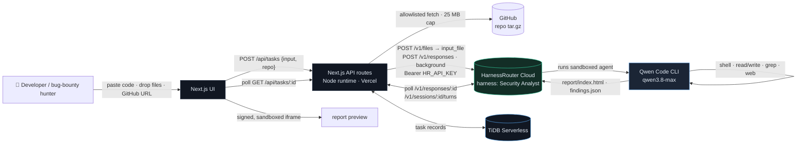

# 🛡️ Sentinel: the security analyst that actually does the work

**Sentinel is an agentic security analyst for developers and bug-bounty hunters.** Paste code, drop
in files, or **just paste a GitHub repo URL**, and Sentinel runs a real, multi-step review inside a
sandboxed agent. You get back a **security grade and triaged findings** (severity, CWE, the exact
file and line, impact, and the fix), a shareable HTML report, and machine-readable JSON. Then one
click asks the same agent for the hardened code. The agent backend is a single **HarnessRouter**
harness running **Qwen Code CLI on `qwen3.8-max`**, a model that will reason through an exploit
path in code you own or a target you're authorized to test, instead of refusing. It's the
difference between *"I can't help with that"* and a prioritized bug list you can act on this
afternoon.

> 🏆 Built for the **HarnessRouter** hackathon. HarnessRouter is the entire agent backend.

---

## The problem

Security work is dual-use, and the frontier US models have responded by **over-refusing**. Ask a
leading Western model to trace an injection, sketch the proof-of-concept reasoning, or review an
auth flow for bypasses (*even on your own code*), and you routinely get a hedge or a flat refusal.
For the people doing legitimate work (defenders hardening their own apps, and bug-bounty hunters
operating under explicit program authorization), that over-refusal is a daily tax: the tool that
should be the force-multiplier is the one slamming the brakes.

## Our solution and our edge

Sentinel routes the agent job through **HarnessRouter** to an **open Chinese model, `qwen3.8-max`
via the Qwen Code CLI harness**, which *engages* with hands-on security analysis instead of
declining it. **That routing decision is the product's edge:** same app, same guardrails, but the
agent does the work.

And we keep the guardrails exactly where they belong: **in the harness's standing instructions**,
which refuse malware, unauthorized intrusion, mass targeting, phishing/credential harvesting, and
detection-evasion. So Sentinel is firmly a tool for **authorized, defensive, and educational**
security. It just removes the false refusals that cripple the genuine use cases.

> Built by a team that has **earned payouts from OpenAI's bug-bounty program**. Sentinel is the
> tool we wished we had while hunting.

## ✨ What you get

| | |
|---|---|
| **Point it at anything** | Paste code, drop in files, or paste a GitHub URL (a repo, a branch, or a folder link). The server fetches the repo archive from GitHub (allowlisted host, 25 MB cap) and uploads it to HarnessRouter's Files API. The agent unpacks it inside its sandbox. |
| **Watch it work** | A live view of the agent's real tool calls (reading code, running analysis commands, writing the report) and a four-stage progress tracker. It's polled from the HarnessRouter session, so nothing has to stream. |
| **A verdict, not a wall of text** | An A-F security grade with a 0-100 score, severity tiles, and filterable, searchable finding cards. Each finding has its `file:line`, CWE, what's wrong, the impact, and a ready-to-paste fix. |
| **The full report** | The agent's own HTML report opens in a locked-down sandboxed preview. `findings.json` and every generated file can be downloaded for your pipeline. |
| **Keep going** | One-click next steps (*hardened drop-in code*, *regression tests*, *PR description*, *explain the top risk*) continue the **same agent session**, with the same files, via `previous_response_id`. If the model provider hiccups mid-run, **Try again** picks up in that session. |
| **Try it instantly** | Three bundled sample reports (real Sentinel runs) open with no wait. |

## Who it's for

| Use case | What Sentinel does |
|---|---|
| **1. Audit your own projects** | Paste a GitHub repo, a file, a diff, a Dockerfile, or your dependency manifest. You get a graded, severity-ranked list of real issues (injection, authz gaps, secrets, misconfig) with concrete fixes, before they ship. |
| **2. Hunt bug bounties** | Point it at code or a system you're authorized to assess and let it reason through exploit paths, rank impact, and draft the finding: the grind a Western model usually refuses. The team behind Sentinel has been paid by **OpenAI's bug-bounty program**; this is the workflow that got us there. |

---

## 💵 Why this is a business, not a demo

**The market.** Every company that ships code has an application-security problem and too few
security engineers. AppSec tooling (SAST/DAST/SCA) is already a multi-billion-dollar market, but
legacy scanners are noisy, rule-based, and don't *explain* or *fix*. Meanwhile the AI assistants
developers already trust refuse the one job that matters most here. Sentinel is the agentic
reviewer that actually does it.

**Who pays**

| Segment | Value |
|---|---|
| **Solo devs & indie teams** | A security reviewer on tap for a few dollars a month. Catch the OWASP-Top-10 stuff before it ships. |
| **Security teams & agencies** | First-pass triage and review at a fraction of an analyst's hourly cost; humans focus on the judgment calls. |
| **Bug-bounty hunters** | One accepted finding is worth hundreds to thousands, so a subscription pays for itself on the first hit. |

**Unit economics.** A full agentic review costs **~$0.20-0.50** through HarnessRouter (with per-task
budget caps), so Sentinel runs comfortably as **per-seat SaaS** (e.g. ~$29/mo) *or* **metered
per-scan** with a free tier. Margins stay healthy either way, and HarnessRouter's per-task cost + budget
ceilings make them predictable.

**Moat / why us**
- **The "willing-model" routing is a config advantage competitors avoid.** Defaulting to models
  that refuse is the industry reflex; we route around it (safely) through HarnessRouter.
- **Report quality + workflow:** a deterministic output contract (severity, CWE/OWASP, exact fix,
  downloadable report + JSON) that fits a developer's day, not a 300-page PDF.
- **Built on HarnessRouter:** the agent is a swappable *resource*, so we ride model improvements
  without re-architecting and keep guardrails + compliance in one auditable place.

**Land-and-expand.** Start at "scan one file," grow into **CI/PR review on every pull request**,
continuous repo monitoring, a findings dashboard, and team seats: the path from a single developer to
securing the whole org.

---

## 🤝 Sponsors & stack

| Technology | Sponsor? | Role in Sentinel |
|---|:--:|---|
| **[HarnessRouter](https://harnessrouter.ai)** | ✅ **Sponsor** | The **entire agent backend.** One `harness` resource is the whole security-analyst agent: base, model, standing instructions, tools, sessions, files and budgets. Our server uploads repos with `POST /v1/files` and starts tasks with `POST /v1/responses`. HarnessRouter runs the multi-step job in a sandbox and returns the answer plus the generated report files. Session turns power the live activity feed. |
| **Qwen Code CLI + `qwen3.8-max`** | Model (via HarnessRouter) | The agent harness + model doing the actual analysis. Chosen because it **does hands-on security work** where Western models over-refuse (our market edge). |
| **Next.js + Vercel** | No | Frontend + serverless API routes. Serverless ⇒ background mode + polling (no held-open streams). |
| **TiDB Serverless** | No | MySQL-compatible durable task store via the HTTP serverless driver. Records survive across serverless invocations (preferred; Vercel KV / Upstash also supported). |
| **ElevenLabs** | No | Voiceover and music bed for the demo video only. |

---

## 🏆 Why HarnessRouter (the sponsor)

HarnessRouter is what makes Sentinel a *product* and not a prompt. We treated the whole agent as
**one configured resource** instead of hand-rolling an LLM loop:

- **The agent is a resource, not code.** We created one harness (`Security Analyst`) via the
  HarnessRouter API. Its base, model, and standing instructions (including all the safety
  guardrails) live *on the harness*, versioned in `harnessrouter.json`, not scattered through our
  app or re-sent on every request. Changing the agent's behavior is an API call + `If-Match`, not a
  redeploy.
- **Model routing is a first-class lever.** Our entire edge ("use a model that does the work") is
  a single field (`base: qwen`, `model: qwen3.8-max`) that HarnessRouter resolves against what our
  workspace can actually run. Swapping models is config, not a rewrite.
- **Real agent runtime, not just completions.** One `POST /v1/responses` gives us a sandboxed,
  multi-step agent with a shell, file tools, sessions, follow-ups, per-task budgets, and
  **generated files** (the HTML report) we fetch back and serve. That's a huge amount of
  infrastructure we didn't have to build.
- **Files and sessions, not just text.** A whole GitHub repo becomes one `POST /v1/files` upload,
  attached to the task as an `input_file`, and the agent unpacks it in its sandbox. The live
  activity feed reads the session's turns. Follow-ups ("give me the fixed code") continue the same
  session, so the agent still has the repo and its own report on disk.
- **Serverless-friendly.** `background: true` + `GET /v1/responses/{id}` polling fits Vercel
  functions perfectly: no minutes-long open connection, and each poll doubles as crash recovery.
- **Clean security boundary.** The key is a server-side HarnessRouter credential; sessions and
  files are addressed by ids the browser never sees. HarnessRouter gave us the seams to keep every
  secret and upstream id server-side.

## 🧠 Why Qwen Code CLI + `qwen3.8-max`

A security analyst that refuses to analyze is useless. In testing, `qwen3.8-max` run through the
**Qwen Code CLI** agent harness consistently **does the hands-on work**: it traces the injection,
reasons about the exploit, writes the PoC logic, and ranks severity, for code you own and targets
you're authorized to test, where leading Western models hedge or refuse outright. The Qwen Code CLI
base also ships exactly the tools a code-level security review needs: a shell, file read/write,
grep/glob, and web fetch, all sandboxed on HarnessRouter. We pair that willingness with
**app-level guardrails on the harness** so the engagement stays authorized and defensive.

---

## 🏗️ Architecture



**The browser only ever talks to our backend.** It never sees the API key, the `harness_id`, upstream
session/response ids, file ids, or raw `download_url`s. One user request is one task (`input` is
what the user typed, plus the attached repo archive). The server sets `metadata.harness_id` and
the signed-in user's id as `user`. Follow-ups reuse the stored `previous_response_id` and
`session_id` to continue the same session. Task records live in **TiDB Serverless**, so polling,
history and follow-ups work across stateless serverless invocations.

## 🔒 Security model (we practice what we preach)

- **Key** lives only in the server env, sent only to `api.harnessrouter.ai`; never in the bundle,
  logs, generated files, or git.
- **Tenancy**: every route authorizes the signed-in user against the task record; a `session_id` is
  never authorization by itself.
- **Generated HTML** is served only through a **signed, short-lived, task-scoped URL** under a strict
  sandbox CSP (no `allow-same-origin`), so it can't touch the app's cookies or origin.
- **Repo fetches are SSRF-safe.** A pasted URL is parsed into owner, repo, ref and folder with strict
  allowlist patterns, then rebuilt server-side against GitHub only. Redirects must stay on GitHub,
  and archives are capped at 25 MB and checked to be gzip before upload.
- **The live feed leaks nothing.** The browser sees friendly labels derived from tool *names* only,
  never tool arguments, paths or output.
- **Agent output is untrusted input.** Replies are rendered by a safe Markdown renderer (no raw
  HTML, `http(s)` links only). Findings are schema-normalized and length-capped before they reach
  the UI. A failed run shows a plain sentence built from the error code, never upstream text.
- **Guardrails** (refuse malware / unauthorized / mass-targeting / phishing / evasion) live in the
  harness instructions, enforced on every task.

---

## ▶️ Run it

```bash
pnpm install
# HarnessRouter key lives in gitignored .env.harnessrouter (HR_API_KEY=sk-hr-…), already set up
pnpm dev          # http://localhost:3000
pnpm test         # adapter, product and shared (grading, findings, markdown safety, GitHub parsing) tests
pnpm build        # production build
```

Full setup, environment variables, and Vercel deployment are in **[DEVELOPMENT.md](DEVELOPMENT.md)**.

- **Harness ID:** `chrn_01a74a33efe94123a15d3d8958abe16d` · base `qwen` · model `qwen3.8-max` · Workspace *Default Workspace*
- **Demo video:** [`demo/sentinel-demo.mp4`](demo/sentinel-demo.mp4) (about 2 min). It shows real screen recordings of a live GitHub repo scan: paste the repo, watch the agent work, explore the graded report, and get the fixed code as a follow-up.
